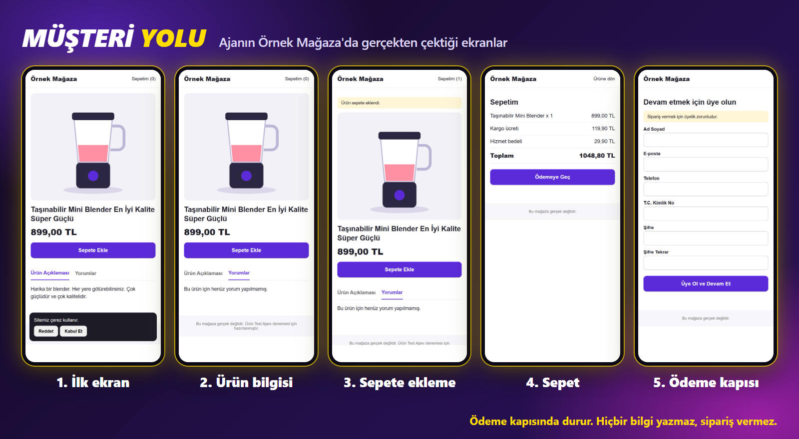

# 1. Başlamadan önce

## Ne lazım?

- **Ücretli Claude planı.** Claude Code; Pro, Max, Ultra, Team ve Enterprise planlarında vardır. Ücretsiz planda yoktur. Ücretsiz plandaysan [9. bölüme](9-claude-code-yoksa.md) git.
- **Windows 10 ya da üstü veya macOS 13 ya da üstü bir bilgisayar.**
- **Chrome ya da Edge.** Ajan siteye bu tarayıcıyla girer.
- **Test edeceğin ilanın linki.** Kendi mağazandan olsun.

Node.js adlı küçük bir program da gerekir. Kurulum kodu onu senin için kontrol eder.

## Ajan ne yapar?

1. Sayfayı telefon görünümünde açar, ne kadar sürede açıldığını ölçer.
2. Çerez ve kampanya pencerelerini kapatır.
3. Ürün görsellerini kaydırır, sayfayı aşağı iner.
4. Ürün özellikleri, yorumlar ve iade gibi sekmeleri açar.
5. Ürünü sepete ekler, sepete gider.
6. Kargo ve ek ücretleri okur.
7. Ödeme kapısına gelir ve durur.
8. Beş sanal müşterinin gözüyle her adımı değerlendirir.
9. Kaçış haritasını ve düzeltme listesini rapor olarak yazar.

## Ajan ne yapmaz?

- Hiçbir forma bilgi yazmaz.
- Ödeme yapmaz, sipariş vermez.
- Hesabına ya da paneline girmez, mağazanda hiçbir şeyi değiştirmez.
- CAPTCHA ya da bot engelini aşmaya çalışmaz.
- Satış ya da ciro tahmini vermez.

Gezinti sırasında reklam ve analiz kodları engellenir. Böylece bu ziyaret reklam verilerine sahte müşteri olarak yazılmaz.

## Bilmen gereken

Sanal müşteri gerçek müşteri değildir. Ajan sana ilk filtreyi verir: "Burada bir eksik var." Gerçek karar için gerçek satış verine bakmaya devam et.

---

**Sonraki:** [2. Claude'u kur](2-claude-kur.md)
