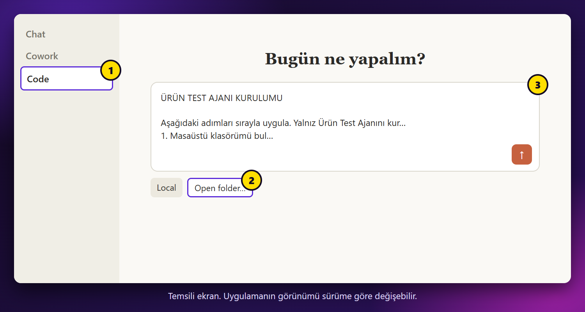

# 2. Claude'u kur

En kolay yol Claude masaüstü uygulamasıdır. Terminal kullanman gerekmez.

## Claude uygulamasını indir

1. [claude.com/download](https://claude.com/download) adresini aç.
2. Bilgisayarına uygun sürümü indir ve kur.
3. Uygulamayı aç, Claude hesabınla giriş yap.

## Code sekmesini aç



1. Sol üstteki **Code** sekmesine tıkla.
2. Yükseltme isteği çıkarsa hesabın ücretsiz plandadır. [9. bölüme](9-claude-code-yoksa.md) git.

Bir sonraki bölümde bu ekrana kurulum kodunu yapıştıracaksın.

<details>
<summary>Terminali tercih ediyorum</summary>

Windows PowerShell:

```powershell
irm https://claude.ai/install.ps1 | iex
```

Mac:

```bash
curl -fsSL https://claude.ai/install.sh | bash
```

Yeni bir terminal aç, giriş yapmak için şunu yaz:

```bash
claude
```

Kaynak: [Claude Code resmi kurulum sayfası](https://code.claude.com/docs/en/setup)

</details>

---

**Sonraki:** [3. Ajanı kur](3-ajani-kur.md)
