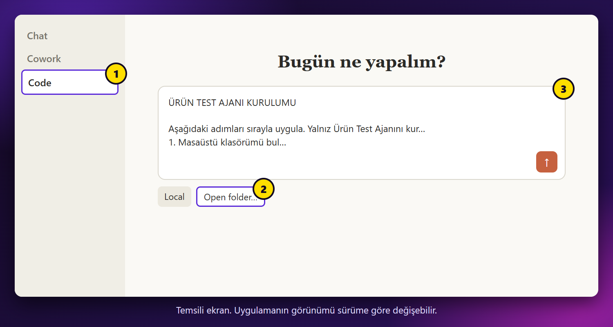

# 3. Ajanı kur

## Adım 1: Klasör seç

Claude uygulamasında **Code** sekmesini aç. Yazı kutusunun altındaki sıradan **Local** seçili olsun. Yanındaki klasör düğmesine tıkla, **Open folder…** ile **Belgeler** klasörünü seç.

Bu klasör yalnız başlangıç noktasıdır. Ajan Masaüstüne kurulacak.



## Adım 2: Kurulum kodunu kopyala

Aşağıdaki kutunun sağ üstündeki kopyala düğmesine bas.

```text
ÜRÜN TEST AJANI KURULUMU

Aşağıdaki adımları sırayla uygula. Yalnız Ürün Test Ajanını kur, başka dosya ya da ayar değiştirme.

1. Masaüstü klasörümü bul. İçinde urun-test-ajani adlı klasör varsa üzerine yazma, bana sor.

2. Şu dosyayı geçici bir klasöre indir ve zipten çıkar:
https://github.com/sametbostanc67-coder/claude-urun-test-ajani/archive/refs/heads/main.zip

3. Zipten çıkan klasörün içindeki kod klasörünü Masaüstüne urun-test-ajani adıyla kopyala. Adı nokta ile başlayan .claude klasörü de kopyalanmalı. Sonra geçici dosyaları sil.

4. node --version ile Node.js sürümüne bak. Node.js yoksa ya da sürüm 20'den küçükse Windows'ta winget install OpenJS.NodeJS.LTS, Mac'te brew install node komutunu çalıştır. Kurulamazsa beni https://nodejs.org adresine yönlendir ve dur.

5. urun-test-ajani klasöründe npm install çalıştır.

6. Aynı klasörde node arac/kontrol.mjs çalıştır. Araç tarayıcı bulamazsa npx playwright-core install chromium çalıştır, sonra kontrolü tekrar et.

7. Çıktıda KURULUM TAMAM görmeden bitti deme. Hata varsa nedenini bul ve düzelt.

8. raporlar/kurulum-kontrol/rapor.html dosyasını tarayıcıda aç.

9. Bana tam olarak şunu söyle: Ürün Test Ajanı kuruldu. Masaüstündeki urun-test-ajani klasörünü Claude'da aç ve /musteri-testi ilan-linki yaz.
```

## Adım 3: Yapıştır ve gönder

Kodu yazı kutusuna yapıştır ve gönder.

Claude senden izin isteyebilir. Okuduğun işlem bu kuruluma aitse onayla.

## Adım 4: Sonucu gör

Her şey tamamsa Claude şunu yazar:

```text
KURULUM TAMAM
```

Tarayıcında örnek rapor açılır. Masaüstünde de `urun-test-ajani` klasörü oluşur.

Takılırsan [8. bölüme](8-sorun-cozme.md) bak.

<details>
<summary>Claude kullanmadan kendim kurmak istiyorum</summary>

Node.js 20 ya da üstü kurulu olmalı. Terminalde sırayla çalıştır:

```bash
git clone https://github.com/sametbostanc67-coder/claude-urun-test-ajani.git
```

```bash
cd claude-urun-test-ajani/kod
```

```bash
npm install
```

```bash
node arac/kontrol.mjs
```

</details>

---

**Sonraki:** [4. İlk testi yap](4-ilk-test.md)
