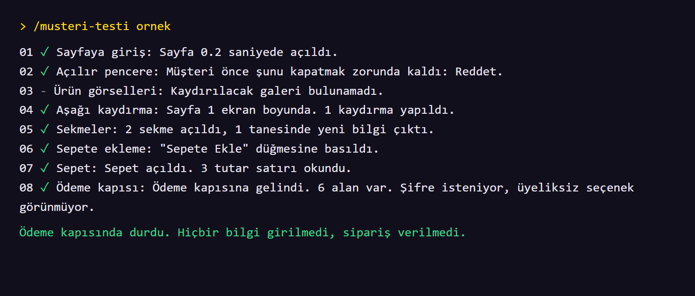

# 4. İlk testi yap

## Klasörü aç

Claude uygulamasında **Code** sekmesinde yeni oturum başlat. **Open folder…** ile Masaüstündeki `urun-test-ajani` klasörünü seç.

Bu önemli. Ajanın komutları yalnız bu klasörde çalışır.

## Önce örnek mağazayı dene

Kitapla birlikte sahte bir mağaza gelir. Gerçek ürün ve gerçek ödeme yoktur. Yazı kutusuna şunu yaz:

```text
/musteri-testi ornek
```

Bir tarayıcı penceresi açılır. Ajan sitede gezer, sen de izleyebilirsin.



Bittiğinde Claude sonucu yazar ve `rapor.html` dosyasının yerini söyler.

## Şimdi kendi ilanını test et

```text
/musteri-testi https://siten.com/urun-linkin
```

Linki kendi ilanınla değiştir.

## Ek seçenekler

| Komut | Ne yapar |
| --- | --- |
| `/musteri-testi link --masaustu` | Bilgisayar görünümünde gezer |
| `/musteri-testi link --sepetsiz` | Sepete eklemeden yalnız ürün sayfasını denetler |
| `/musteri-testi link --gizli` | Tarayıcı penceresi açmadan çalışır |

## Bilmen gerekenler

- Sepete ekleme sipariş oluşturmaz. Ajan ödeme kapısında durur.
- Stok takibin sepete eklenince düşüyorsa `--sepetsiz` kullan.
- Trendyol ve Hepsiburada gibi pazaryerleri otomatik ziyareti engelleyebilir. Ajan engeli aşmaz, senden ekran görüntüsü ister.
- Kendi ilanlarını test et. Başka sitelerde kullanmadan önce o sitenin kurallarına bak.

---

**Sonraki:** [5. Raporu oku](5-raporu-oku.md)
