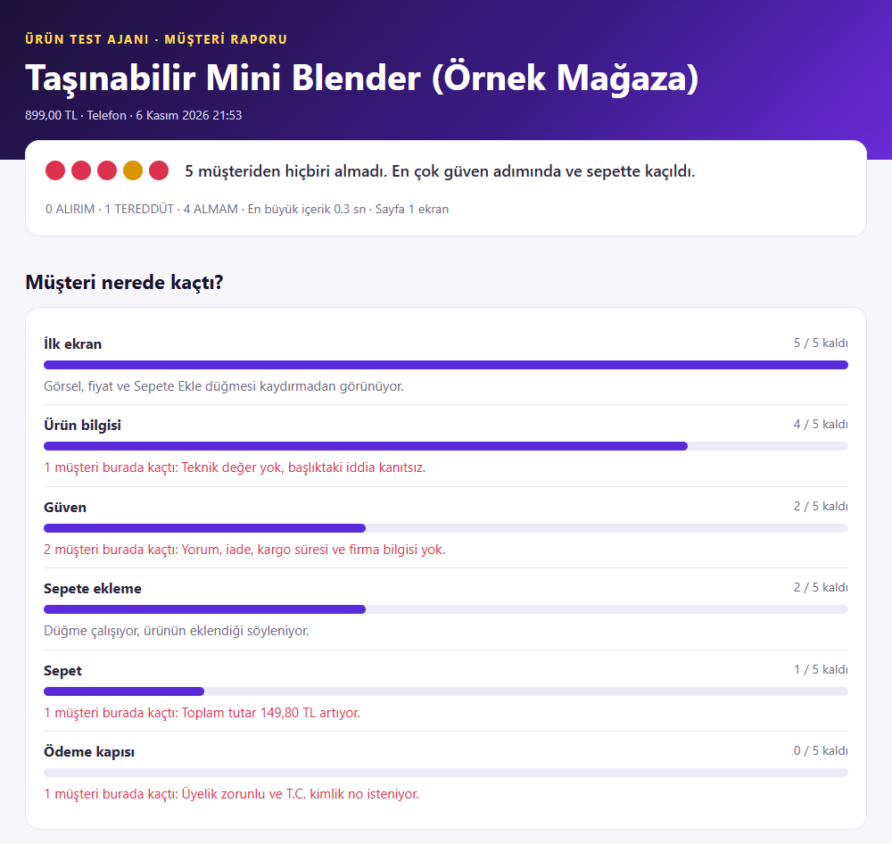
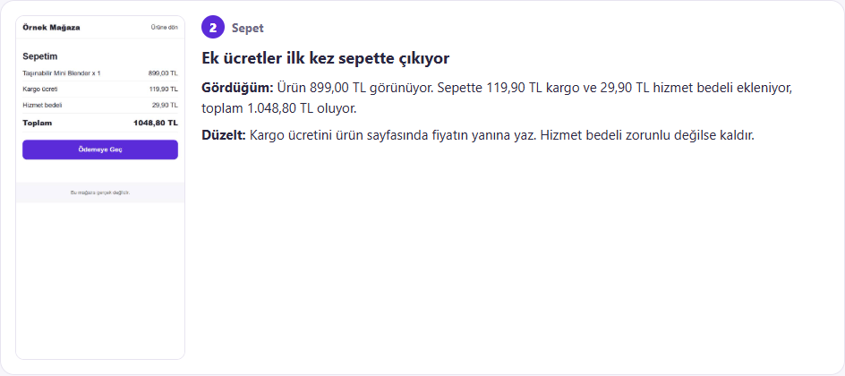
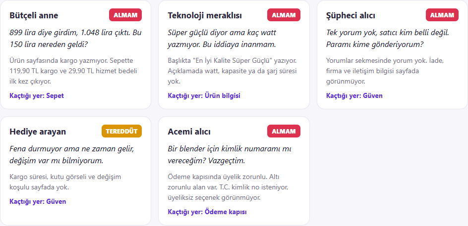

# 5. Raporu oku

Her test `raporlar` klasöründe yeni bir klasör açar. İçindeki `rapor.html` dosyasına çift tıkla.

Aşağıdaki görseller Örnek Mağaza için üretilen gerçek rapordan alındı.

## Müşteri nerede kaçtı?

Üstteki noktalar beş müşterinin kararıdır. Altındaki harita müşterilerin hangi adımda azaldığını gösterir. En büyük düşüş senin ilk işindir.

## Bugün düzelt

Her kartta üç şey var:

- **Gördüğüm:** Ajanın ekranda gördüğü gerçek durum.
- **Düzelt:** Bugün yapacağın tek iş.
- **Hazır metin:** Varsa kopyalayacağın metin. Köşeli parantez içindeki yerlere gerçek bilgini yaz.

Ajan ürün bilgini bilmez. Köşeli parantezleri tahminle doldurma.

## Beş müşteri ne dedi?

| Karar | Anlamı |
| --- | --- |
| ALIRIM | Yolu bitirdi, eksik görmedi |
| TEREDDÜT | İçi rahat değil, küçük bir eksik onu kaybettirir |
| ALMAM | Bu eksik yüzünden çıktı |

## Düzelttikten sonra

İlanı düzelt ve aynı testi tekrar çalıştır. Kaçış haritası değişiyor mu bak. Eski raporlar `raporlar` klasöründe kalır, karşılaştırabilirsin.

---

**Sonraki:** [6. Ajanı eğit](6-ajani-egit.md)
