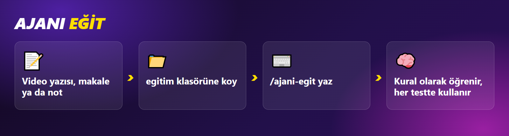

# 6. Ajanı eğit

Ajan ilk günden müşterinin neden kaçtığını bilir. Bu eğitim `bilgi/musteri-davranisi.md` dosyasındadır. Sen de ona kendi sektöründen yeni şeyler öğretebilirsin.



## Bir eğitim videosu öğret

Ajan videoyu izleyemez. Videonun yazısını okur.

1. YouTube'da videonun açıklamasını aç, **Transkripti göster** düğmesine bas.
2. Yazıyı kopyala.
3. `urun-test-ajani/egitim` klasöründe `.txt` dosyası aç, yazıyı yapıştır, kaydet. Örnek ad: `sepet-terk-videosu.txt`
4. Claude'a şunu yaz:

```text
/ajani-egit egitim/sepet-terk-videosu.txt
```

Ajan müşteri davranışıyla ilgili bilgileri seçer, kendi cümlesiyle kural yapar ve `bilgi/ogrenilenler.md` dosyasına yazar. Bundan sonraki her testte bu kuralları kullanır.

## Makale ya da not öğret

Makale linki:

```text
/ajani-egit https://ornek.com/makale
```

Kendi gözlemin:

```text
/ajani-egit Müşterilerim kargo süresini sormadan sipariş vermiyor.
```

## Kendi müşterini ekle

`bilgi/musteriler` klasöründeki dosyalardan birini kopyala, adını değiştir, içini kendi müşterine göre yaz. Örnek:

```markdown
# Toptan alıcı

Mağazası için çok adet alır.

**Baktığı yer:** Adet indirimi, fatura, stok, kargo süresi.

**Kaçar:**
- Adet indirimi yazmıyorsa.
- Fatura bilgisi yoksa.

**Konuşması:** Net konuşur. "Elli adet alırsam fiyat ne olur?" der.
```

Ajan bir sonraki testte bu müşteriyi de yola çıkarır.

---

**Sonraki:** [7. Bütün kodlar](7-butun-kodlar.md)
