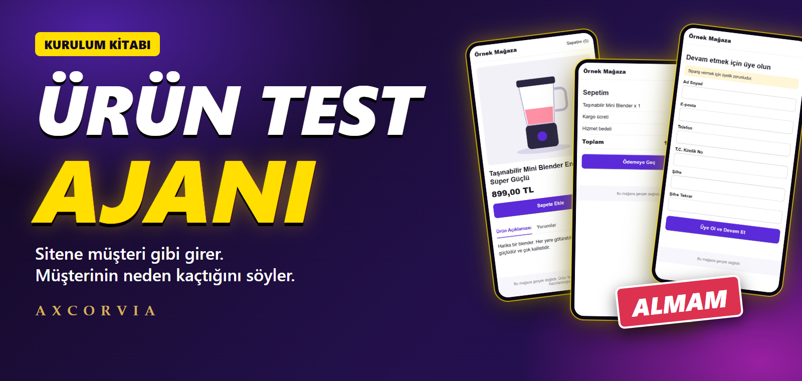
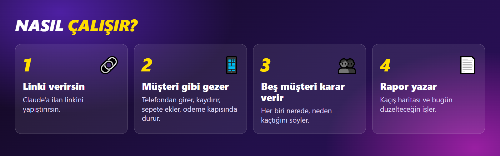

# Kurulum Kitabı

Kurulum yaklaşık 15 dakika sürer. Kod yazmayı bilmen gerekmez, sırayla ilerle.

## İçindekiler

| Bölüm | Konu |
| --- | --- |
| [1. Başlamadan önce](1-baslamadan-once.md) | Ne lazım, ajan ne yapar, ne yapmaz |
| [2. Claude'u kur](2-claude-kur.md) | Claude uygulaması ve Code sekmesi |
| [3. Ajanı kur](3-ajani-kur.md) | **Kurulum kodu burada** |
| [4. İlk testi yap](4-ilk-test.md) | Önce örnek mağaza, sonra kendi ilanın |
| [5. Raporu oku](5-raporu-oku.md) | Müşteri nerede kaçtı, ne düzelteceksin |
| [6. Ajanı eğit](6-ajani-egit.md) | Yeni bilgi öğret, yeni müşteri ekle |
| [7. Bütün kodlar](7-butun-kodlar.md) | Dosyaların tamamı, A'dan Z'ye |
| [8. Sorun çözme](8-sorun-cozme.md) | Takılırsan buraya bak |
| [9. Claude Code yoksa](9-claude-code-yoksa.md) | Ücretsiz planda ne yapabilirsin |

**Başla:** [1. Başlamadan önce](1-baslamadan-once.md)
